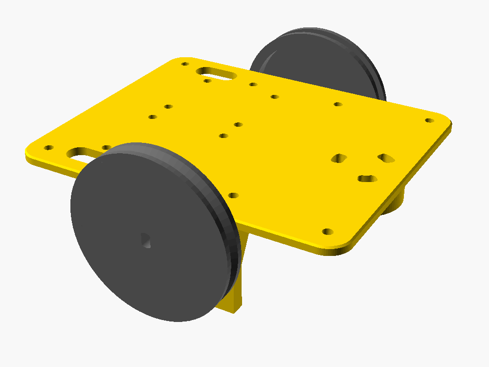

# 🐝 VızVızBot

**5 yaşındaki yeğenim için evde yapılmış, Bee-Bot tarzı programlanabilir bir arı robot.**

Çocuk, robotun sırtındaki ok tuşlarıyla bir yol giriyor (ileri, ileri, sağa, ileri…), **GO**'ya basıyor ve robot o yolu kare kare yürüyor. Ekran yok, uygulama yok. Algoritmik düşünmeyi oyunla öğreten basit bir oyuncak.

Bu repo; 3D baskı parçalarını (OpenSCAD kaynaklarıyla birlikte), Arduino kodunu, baskı ayarlarını ve yol boyunca yaşanan bütün hataları içeriyor. Geliştirme günlüğü için: [`docs/GUNLUK.md`](docs/GUNLUK.md)

---

## Durum

| Bölüm | Durum |
|---|---|
| Tolerans testi | ✅ Tamam (0.3 mm) |
| Şasi | 🔄 v5: plaka + ayrı braketler, basılmayı bekliyor |
| Tekerler | 🔄 v3: 5 kollu, vidalı göbek, basılmayı bekliyor |
| Sarhoş teker montajı | 🔄 v5'te delikler genişletildi |
| Elektronik (motorlar + sürücüler + güç) | ⏳ Sırada |
| İlk sürüş ve kalibrasyon | ⏳ |
| Kabuk, tuş kapakları, kanatlar | ⏳ Tasarlandı, basılmadı |
| Yazıcı: nozül termistörü arızası | ⚠️ Teşhis edildi, değişim bekliyor |

---

## Malzeme listesi

| Parça | Adet | Not |
|---|---|---|
| Arduino Nano | 1 | |
| 28BYJ-48 step motor (5V) | 2 | |
| ULN2003 sürücü kartı | 2 | Motorla birlikte gelen |
| 6×6 mm tach buton (12 mm boy) | 6 | İleri, geri, sol, sağ, GO, sil |
| Pasif buzzer + 220 Ω direnç | 1 | |
| Sarhoş teker (ball caster) | 1 | Kendi cıvata ve somunlarıyla (27 mm) |
| O-ring (3 mm kesit) | 2 | Teker lastiği |
| 4×AA pil yuvası + Ni-MH pil | 1 | |
| Anahtar (switch) | 1 | |
| 1N5819 Schottky diyot | 1 | Ters pil koruması |
| 470 µF kondansatör | 1 | 5V hattına |
| M3 ısıl insert (4.0 mm dış çap) | 12 | 4 braket + 8 kabuk |
| M3 × 10 vida + somun | ~10 | Motor kulakları, teker göbeği, braketler |
| PLA filament | ~150 g | |

---

## Baskı

**Yazıcı:** Creality Ender-3 V2 Neo (CR Touch) · **Dilimleyici:** Cura 5.13

| Dosya | Yön | Not |
|---|---|---|
| `stl/vizvizbot_sasi_v5_plaka.stl` | Plakanın üst yüzü tablada | Desteksiz |
| `stl/vizvizbot_sasi_v5_braketler.stl` | **Yan yatık** (dosyadaki gibi) | Desteksiz. Bu yön braketin gücünün sırrı, değiştirme |
| `stl/vizvizbot_teker_v3.stl` | Dış yüz tablada | 2 teker, desteksiz |
| `stl/vizvizbot_kabuk_v1_*.stl` | | Kabuk için tabladan destek gerekir |

**Ayarlar:** 0.2 mm katman · 4 duvar · %40 dolgu · PLA 200 °C / tabla 60 °C · fan %80 · brim · başlangıç G-code'unda `G28` sonrasına `G29` (CR Touch).

Kendi ölçülerine göre değiştirmek için `cad/` klasöründeki `.scad` dosyalarını OpenSCAD ile aç. Bütün ölçüler dosyaların başında, açıklamalı değişkenler olarak duruyor.

---

## Montaj (özet)

1. **Isıl insert'leri** braket flanşlarındaki deliklere havya ile göm.
2. **Braketleri** plakanın altına, plakanın üstünden geçen 2'şer M3×10 vidayla bağla.
3. **Motorları** braketlere dışarıdan sok. **Mil yukarıda**, plakaya yakın tarafta olmalı. Kulaklardan M3 vida + somunla sabitle.
4. **Sarhoş tekeri** arkadaki yükselticiye kendi cıvatalarıyla bağla. Yay şeklindeki delikler hizalama payı veriyor.
5. **Tekerler:** somunu göbekteki yuvaya düşür, M3×10 vidayı içeriden başlat, tekeri mile tak (milin düz yüzü vidaya baksın), janttaki küçük delikten sık, en son O-ring'i tak.

---

## Elektronik

| Bağlantı | Arduino pini |
|---|---|
| Sol motor sürücüsü IN1–IN4 | D4, D5, D6, D7 |
| Sağ motor sürücüsü IN1–IN4 | D8, D9, D10, D11 |
| Buton: ileri / geri / sol | D2 / D3 / D12 |
| Buton: sağ / GO / sil | A0 / A1 / A2 |
| Buzzer (+) | A3, 220 Ω üzerinden |

- Butonların bir ucu pine, diğer ucu GND'ye. Kodda `INPUT_PULLUP` kullanılıyor, harici direnç gerekmiyor.
- **Güç:** 4×AA → anahtar → 1N5819 → 5V hattı (Nano 5V pini + iki ULN2003). 5V ile GND arasına 470 µF. **Bütün GND'ler ortak.**

---

## Yazılım

| Dosya | Ne yapar |
|---|---|
| `firmware/beebot_sim/` | Ana program: tuşlarla komut girilir, GO ile çalışır, sil ile hafıza temizlenir (en fazla 30 komut) |
| `firmware/ilk_surus_testi/` | Butonsuz kalibrasyon: 1 kare ileri → 90° sağ → 1 kare ileri. Ölçüp `ADIM_KARE` ve `ADIM_DONUS`'u ayarla |
| `firmware/garage_riff/` | Buzzer testi için küçük bir riff 🎸 |
| `tools/PID_AYAR_NOZUL.gcode` | Yazıcının nozülü için PID otomatik ayarı |

Kalibrasyon başlangıç değerleri: `ADIM_KARE = 3268` (15 cm, 60 mm teker, yarım adım) · `ADIM_DONUS = 1910` (teker arası ~112 mm).

---

## Öğrendiklerim (kısa liste)

- **Önce tolerans testi bas.** 10 dakikalık bir test parçası saatlerce yeniden baskıdan kurtarır.
- **Katman yönü her şeydir.** Aynı braket dik basılınca kırıldı, yan yatırılınca kat kat güçlü.
- **Sürtünmeyle duran teker eninde sonunda gevşer.** Vida ile kilitle.
- **Sensör de yalan söyleyebilir.** Nozül 1 saniyede 20 °C düşemez. Ekranda düşüyorsa sorun ölçümde.
- **Bir şeyi düzeltirken yenisini bozabilirsin.** Vida ekledim, tornavidanın vidaya ulaşamadığını sonradan fark ettim.

Ayrıntılar: [`docs/GUNLUK.md`](docs/GUNLUK.md)

---

## Lisans

Kod: MIT · 3D modeller: CC BY-SA 4.0. Ayrıntılar için [`LICENSE`](LICENSE).

*Bee-Bot, TTS Group'un ticari markasıdır. Bu proje onlarla bağlantılı değildir. Fikirden ilham alan, sıfırdan tasarlanmış bağımsız bir hobi projesidir.*
